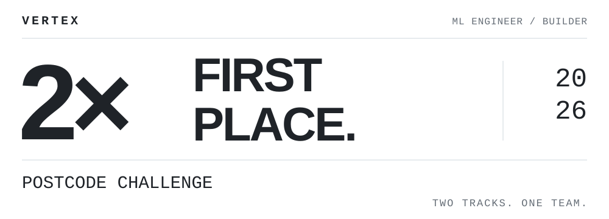

<picture>
  <source media="(prefers-color-scheme: dark)" srcset="./assets/postcode-winner-dark.svg">
  <source media="(prefers-color-scheme: light)" srcset="./assets/postcode-winner-light.svg">
  
</picture>

I build ML-driven products end to end — from data and models to the backends and interfaces people use.
Natural language, computer vision, and the engineering that turns experiments into products.

**Open to founder-led teams building something useful.** [Let's talk →](mailto:danilprolook333@gmail.com)

---

## § 01 — Two Tracks. Two First Places.

**PostCode Challenge 2026 · Team «Mega Команда» · 1st place in both tracks**

### 01 / Support Intelligence

**Track: «Мониторинг и категоризация обращений»**

**Pulse Support / «Пульс поддержки»** — an AI assistant for Service Desk teams. Categorizes incoming requests, recommends a support line, retrieves similar resolved cases, and makes workload and SLA history easier to explore. The operator stays in control.

`NLP` · `Semantic search` · `Classification` · `LLM-assisted analytics`

### 02 / Transport Load Estimation

**Track: «Загрузка транспорта по фото»**

Estimate how full a truck's cargo space is from a photograph. Computer vision combines load estimation, cargo segmentation, and depth analysis to support visual inspection.

`Computer vision` · `Model ensembles` · `Segmentation` · `Depth estimation`

*Two team wins. Two different ML problems. Working services beyond the model.*

---

## § 02 — Selected Public Work

<table>
<tr>
<td width="50%" valign="top">
<h3>01 / LLM QA</h3>

<strong>Python · PyTorch · CatBoost</strong>

Russian QA verification: QA-consistency checks, a CatBoost scorer, and a rank-average ensemble.

<a href="https://github.com/vertexvisionart/llm-hallucination-detector">View repository →</a>
</td>
<td width="50%" valign="top">
<h3>02 / Edge AI &amp; Kernel Work</h3>

<strong>Linux kernel · ARM · C</strong>

Orange Pi 6 Plus NPU driver port from Linux 6.6 to 6.12, with ResNet-50 inference bring-up.

<a href="https://github.com/vertexvisionart/orange-pi-npu-port">View repository →</a>
</td>
</tr>
<tr>
<td width="50%" valign="top">
<h3>03 / Real Estate Pricing</h3>

<strong>Python · CatBoost</strong>

Apartment price regression with a CatBoost ensemble, feature interactions, and target encoding.

<a href="https://github.com/vertexvisionart/cian-price-regression">View repository →</a>
</td>
<td width="50%" valign="top">
<h3>04 / Tabular ML</h3>

<strong>Python · CatBoost</strong>

Tabular ML pipeline with stacking, target encoding, and engineered feature interactions.

<a href="https://github.com/vertexvisionart/ml-competition-ensemble">View repository →</a>
</td>
</tr>
<tr>
<td width="50%" valign="top">
<h3>05 / K-means in C</h3>

<strong>C99 · Algorithms</strong>

Clustering library with K-means++ initialization, multiple restarts, elbow analysis, and silhouette scoring.

<a href="https://github.com/vertexvisionart/kmeans-c">View repository →</a>
</td>
<td width="50%" valign="top">
<h3>06 / C Basics</h3>

<strong>C · Data structures</strong>

Algorithms and data structures through textbook problems, LeetCode, and a multi-strategy ant problem.

<a href="https://github.com/vertexvisionart/c-programming">View repository →</a>
</td>
</tr>
</table>

---

## § 03 — Build Log

<picture>
  <source media="(prefers-color-scheme: dark)" srcset="https://raw.githubusercontent.com/vertexvisionart/vertexvisionart/output/github-contribution-grid-snake-dark.svg">
  <source media="(prefers-color-scheme: light)" srcset="https://raw.githubusercontent.com/vertexvisionart/vertexvisionart/output/github-contribution-grid-snake.svg">
  
</picture>

---

## § 04 — Let's Build

[Email](mailto:danilprolook333@gmail.com) · [Telegram](https://t.me/A1245623)

*Models are a starting point. Useful products are the goal.*
